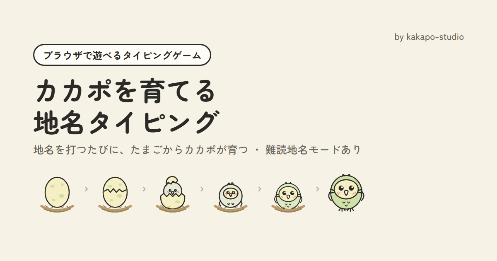
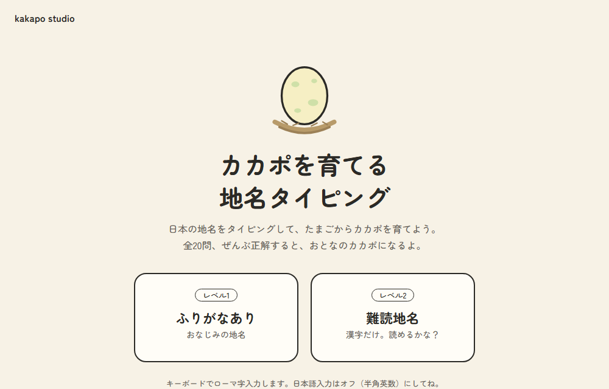
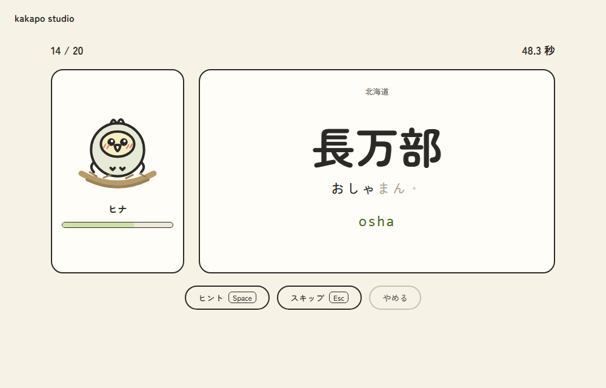
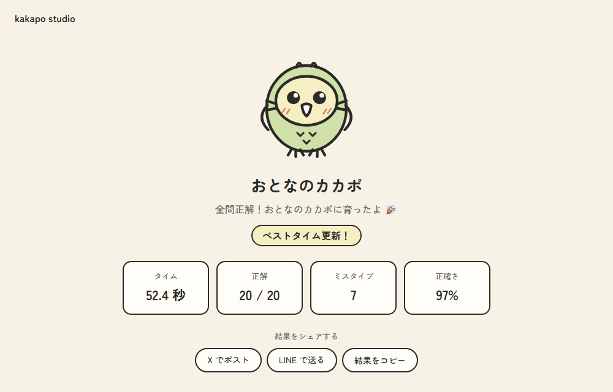

# カカポを育てる地名タイピング

日本の地名をタイピングして、たまごからカカポを育てるブラウザゲームです。
HTML・CSS・JavaScript だけで作っています。

### ▶ [ゲームを遊ぶ](https://kakapo-studio.github.io/typing-game/)（PC・キーボード向け）



| タイトル | プレイ中（レベル2） | 結果 |
|:---:|:---:|:---:|
|  |  |  |

## 遊び方

1. レベルを選ぶ
   - **レベル1**：ふりがな付きのおなじみの地名
   - **レベル2**：漢字だけの難読地名（長万部、放出、太秦 など）
2. 表示された地名の読み方を、ローマ字で入力する
3. 正解するとカカポがリムの実を食べて、4問ごとに1段階育ちます
4. 全20問に正解すると、おとなのカカポに育ちます

| キー | はたらき |
|---|---|
| `Space` | ヒント（レベル2：読みを1文字ずつ表示） |
| `Esc` | スキップ（カカポは育ちません） |

## 特徴・工夫した点

- **ローマ字の打ち方の違いに対応**
  `shi`/`si`、`chi`/`ti`、`tsu`/`tu`、`n`/`nn`、「っ」の重ね打ち（`kucchann`/`kutchann`/`kuttyann`）などを受け付けます。
  「`n` を1回打った時点では『ん』か『な行』の途中か決まらない」問題を、次のキーを見てから確定するしくみで解決しています（`romaji.js`）。
- **育成の演出**
  たまご → ひび → うまれた → ヒナ → わかどり → おとな の6段階。正解すると本物のカカポの好物「リムの実」を食べ、ミスタイプすると小石がコツンと当たります。
- **レベル2は読みを隠す**
  ローマ字のお手本を出さず、打てた分だけ読みが現れます。ヒントで1文字ずつ確認できます。
- **各レベル100問からランダムに20問**
  都道府県も表示し、結果画面で今回の地名と読み方を一覧で振り返れます。
- **ベストタイムの保存・SNS シェア**
  全問正解したときのタイムをブラウザに保存し、結果を X・LINE でシェアできます。
- **日本語入力がオンのままのときは警告を表示**

## 使用技術

- HTML / CSS / JavaScript（ライブラリ・フレームワーク不使用）
- localStorage（ベストタイムの保存）
- GitHub Pages（公開）

## ファイル構成

```
typing-game/
├── index.html     画面（タイトル・カウントダウン・プレイ・結果）
├── style.css      見た目
├── script.js      ゲームの進行・演出・シェア
├── romaji.js      ローマ字判定のしくみ
├── stages.js      カカポの成長段階の絵（SVG）
├── questions.js   問題データ（レベル1・2 各100問）
├── favicon.svg
└── images/        OGP 画像・スクリーンショット
```

## 問題の追加・変更方法

`questions.js` の `LEVEL1` / `LEVEL2` に、次の形のデータを追加します。

```js
{ kanji: "地名", kana: "よみかた", pref: "都道府県" },
```

## 作者

kakapo（[kakapo-studio](https://github.com/kakapo-studio)）

ポートフォリオ：https://kakapo-studio.github.io/
